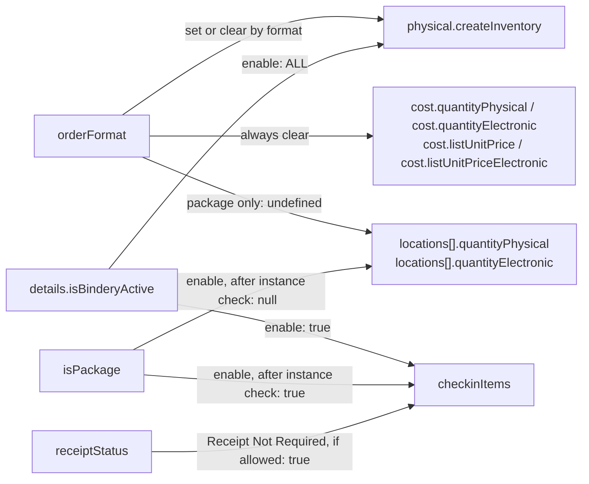
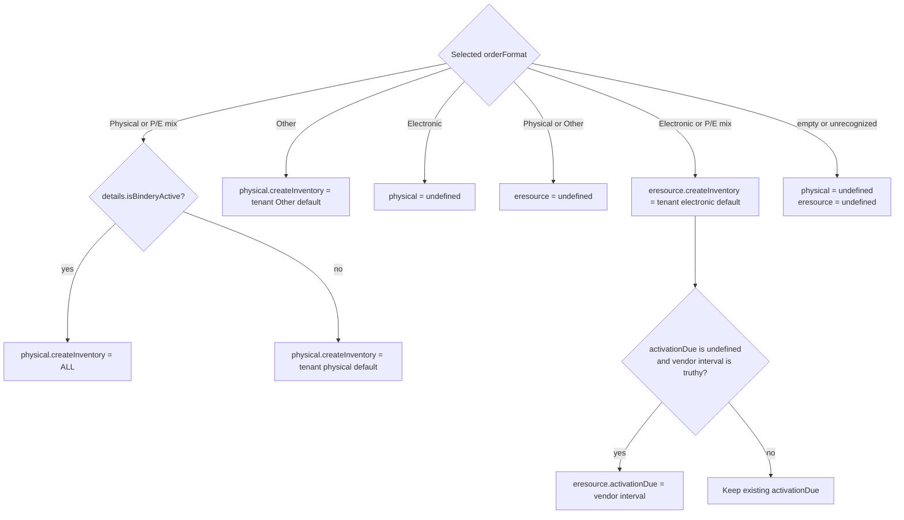
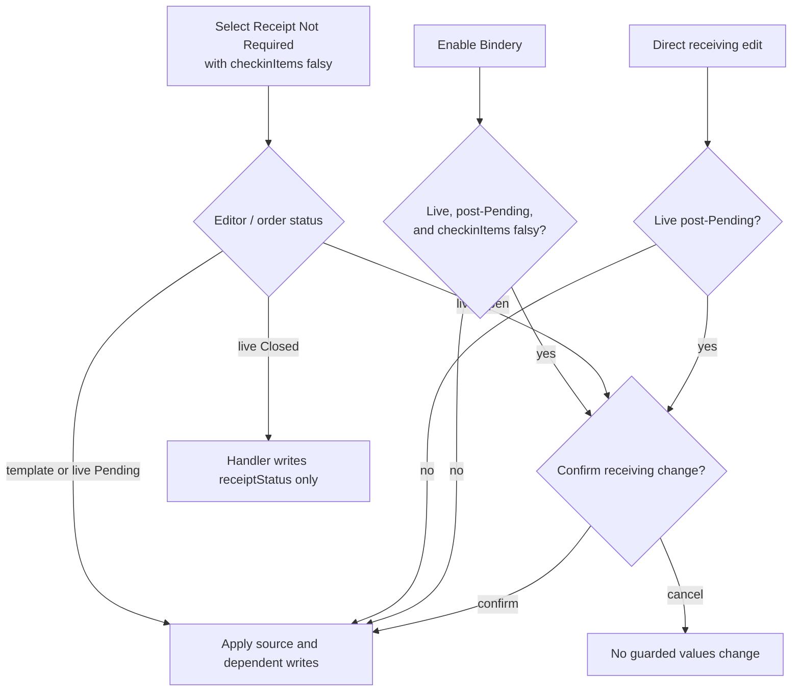
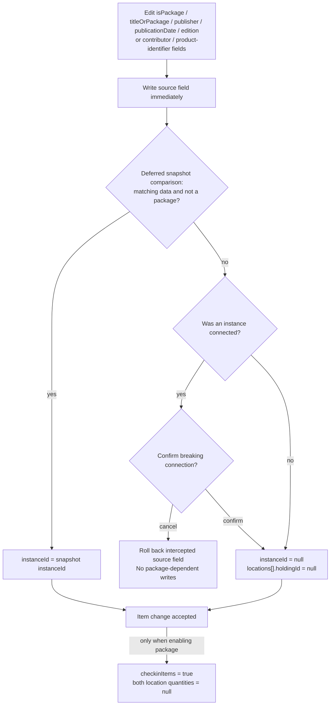
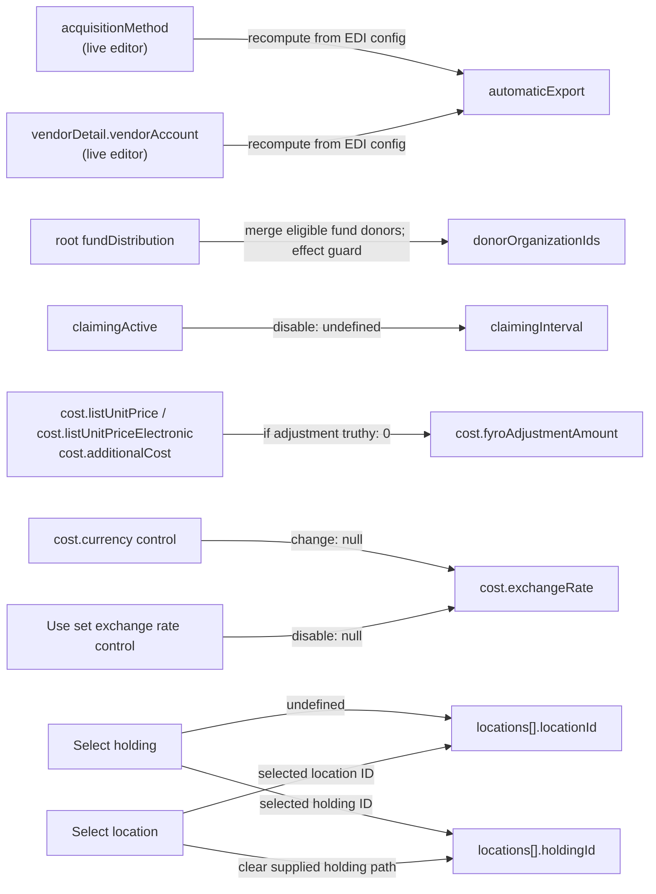
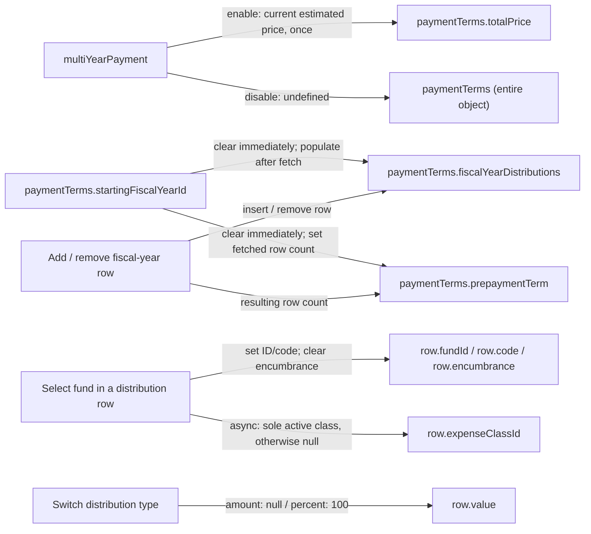
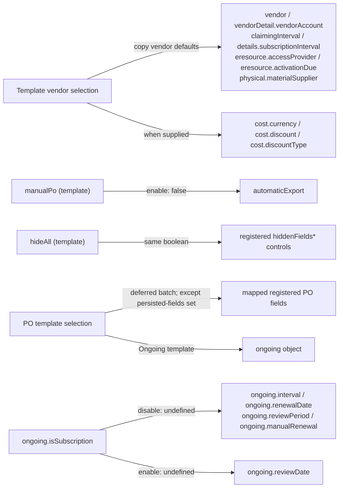
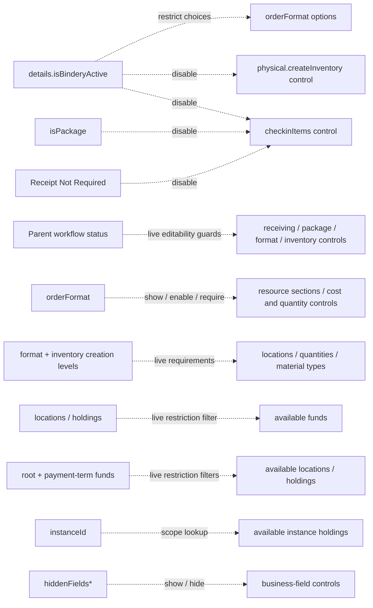

# PO Line Form: Game-Changer Fields

## Dependency map at a glance

Read a solid arrow as **changing the source can write the target, subject to the edge's condition**. It does not mean every assignment to the source triggers a subscription. `ALL` means `Instance, Holding, Item`.

**Shared targets are the collision points:** inventory has both format and Bindery writers; receiving has Bindery, package, and receipt-status writers. Disabling package/Bindery or leaving Receipt Not Required does not reverse those receiving writes. Receipt Not Required forces receiving only when it is currently falsy, and not for a Closed live order; Open live orders require confirmation.

Focused graphs below separate [inventory decisions](#1-order-format-and-inventory), [receiving confirmations](#2-receiving-bindery-packages-and-receipt-status), [instance connections](#3-bibliographic-fields-and-the-instance-connection), [other field writes](#4-other-dependent-value-changes), [payment terms](#5-multi-year-payments), [template controls](#6-template-and-purchase-order-context), and [UI-only dependencies](#7-availability-validation-and-calculated-values).

## Scope and terminology

This document describes the current PO line editor and order template editor, including their shared fields and relevant purchase-order controls. It records existing behavior, not a proposed rules engine.

- Field names below are stored paths, not `POL_FORM_FIELDS` property names. For example, Bindery is `details.isBinderyActive`.
- `checkinItems: true` means **Independent** receiving; `false` means **Synchronized** receiving. Some templates omit this value.
- A **value change** writes form data. An **availability dependency** changes options, visibility, validation, or editability without necessarily changing data.
- Most value changes below run from explicit UI handlers. A direct `form.change`, initialization, or refresh does not automatically replay those handlers. Donor synchronization is an existing effect-driven exception.
- “Pending”, “Open”, and “Closed” refer to the parent order's workflow status. The template editor supplies a synthetic Pending order to shared item/cost forms; its details form has separate handlers.

## 1. Order format and inventory

Owner: [FieldOrderFormat.js](../../common/POLFields/DetailsFields/FieldOrderFormat.js), shared by live PO lines and templates.

### Decision flow: resource values after selecting a format

Arrows in this flowchart show execution branches. Cost/location resets happen independently, as shown in the overview.

Every order-format selection, including clearing the selection:

1. Writes `orderFormat` (empty selection becomes `undefined`).
2. Clears `cost.quantityPhysical`, `cost.quantityElectronic`, `cost.listUnitPrice`, and `cost.listUnitPriceElectronic` to `undefined`.
3. If `isPackage` is truthy, clears both quantities on every `locations[]` row to `undefined`.
4. Applies the selected format's resource changes:

| Selected format | Resource value changes |
| --- | --- |
| Physical resource | Clears the entire `eresource` object. Sets `physical.createInventory` to `Instance, Holding, Item` when Bindery is active; otherwise uses the tenant physical default. |
| P/E mix | Sets both inventory defaults, with the same Bindery override for physical inventory. Does not clear either resource object. |
| Electronic resource | Clears the entire `physical` object. Sets `eresource.createInventory` to the tenant electronic default. |
| Other | Clears the entire `eresource` object. Sets `physical.createInventory` to the tenant Other default. |
| Empty/unrecognized value | Clears both resource objects. |

For Electronic and P/E mix, `eresource.activationDue` is filled from `vendor.expectedActivationInterval` only when its current value is `undefined` and the vendor interval is truthy. An existing value, including `0` or `null`, is not replaced. The template details form does not pass a vendor to this field.

While Bindery is active, selectable non-empty formats are limited to Physical resource and P/E mix. The placeholder remains available. These options do not normalize an incompatible value loaded from a record.

The Bindery override fixes [UIOR-1582](https://folio-org.atlassian.net/browse/UIOR-1582): selecting a physical format must not replace Bindery's required inventory with a weaker tenant default. This applies both to the initial selection and Physical/P/E mix switches.

## 2. Receiving, Bindery, packages, and receipt status

Owners:

- [Live details form](POLineDetails/POLineDetailsForm.js)
- [Template details form](../../settings/OrderTemplates/OrderTemplatesEditor/POLineDetailsForm/POLineDetailsForm.js)
- [Shared Bindery handler](../../common/POLFields/DetailsFields/FieldBinderyActive/handleBinderyActiveFieldChange.js)
- [ItemForm.js](Item/ItemForm.js)
- [Receiving confirmation hook](hooks/useReceivingWorkflowChange/useReceivingWorkflowChange.js)

### Confirmation flow: receiving changes

This flow applies to receiving-workflow confirmation only. The package's instance-connection check has different timing, shown in section 3.

The graph describes handlers, not permission to edit: disabled controls can prevent a path from being reachable in the UI. On the direct-edit path, “Apply” writes only `checkinItems`; the other paths write the source and dependencies listed below.

### Explicit value changes

| Event | Changes after any required confirmation | Live PO line confirmation | Template behavior |
| --- | --- | --- | --- |
| Enable `details.isBinderyActive` | In a batch, sets Bindery to `true`, `physical.createInventory` to `Instance, Holding, Item`, and `checkinItems` to `true`. | Before writing, prompts when the order is post-Pending and receiving is currently falsy. | Same writes, without receiving confirmation. |
| Disable Bindery | Sets only Bindery to `false`. Does not restore a previous inventory or receiving value. | No receiving confirmation. | Same. |
| Enable `isPackage` | After the item/instance check succeeds, sets `checkinItems` to `true` and both location quantities to `null` in a batch. | May require breaking the connected instance; see section 3. | Uses the same item handler. |
| Disable package | Keeps the current receiving value and location quantities. Does not force `checkinItems` to `false`. | Uses the same item/instance check. | Same. |
| Select `receiptStatus = Receipt Not Required` while receiving is falsy | Writes receipt status, then sets `checkinItems` to `true`. In the live form, this receiving change is skipped for Closed orders. | Open orders prompt before either write; Pending orders do not. | Writes both without confirmation. |
| Select another receipt status, or select a status when receiving is already true | Writes only receipt status. Empty selection becomes `undefined`. | No receiving confirmation for this branch. | Same. |
| Directly select receiving workflow | Writes only `checkinItems`; does **not** change `receiptStatus`. | Post-Pending orders prompt before writing; Pending orders write immediately. | Writes immediately. |

Cancelling a receiving-workflow confirmation leaves the guarded source and dependent values unchanged. This differs from the item/instance confirmation, which uses source-field rollback.

Removing a reason for Independent receiving does not imply that Synchronized receiving is desired. Disabling package, disabling Bindery, or leaving Receipt Not Required therefore does not restore a historical receiving value.

### Availability dependencies (not additional writes)

- **Receiving** is disabled in the live form for Closed orders, packages, active Bindery, Receipt Not Required, or post-Pending orders already using Independent receiving. Templates disable it only for package, Bindery, or Receipt Not Required.
- **Bindery** is unavailable for Electronic/Other formats. A blank format does not disable it. With a format selected, post-Pending live orders also require physical inventory already equal to `Instance, Holding, Item`. Templates omit that workflow/inventory restriction. See [POLFields/utils.js](../../common/POLFields/utils.js).
- **Physical inventory** is disabled while Bindery is active. Live inventory fields are also non-interactive after Pending. Disabling a control does not repair its value.
- **Package** is disabled after Pending and when creating a line from an instance. Package affects title labels, instance-selection availability, cost labels, quantity visibility, and location validation in addition to the writes above.
- **Order format** is non-interactive after Pending in the live editor. Templates do not have this restriction.

## 3. Bibliographic fields and the instance connection

Owners: [ItemForm.js](Item/ItemForm.js), [item utilities](Item/util.js), [ContributorForm.js](Item/ContributorForm.js), and [ProductIdDetailsForm.js](Item/ProductIdDetailsForm.js).

### Connection-check flow: editing item fields

Explicit instance selection follows a different path: it fills bibliographic fields directly and clears all locations when replacing an already connected instance. It does not use the edit/rollback flow above.

### Selecting an inventory instance

The explicit instance-selection handler fills:

- `instanceId`, `titleOrPackage`, `publisher`, `publicationDate`, and `edition`;
- `contributors` and `details.productIds` (using allowed identifier types and ISBN qualifier parsing);
- `suppressInstanceFromDiscovery`.

Selecting a different instance when one was already connected also clears the entire `locations` array. This is a selection-handler dependency, not a subscription to arbitrary changes of `instanceId`.

### Editing fields that can break the connection

Changes to `isPackage`, title, publisher, publication date, edition, contributor fields, and product-identifier fields use the item connection check.

1. The source field is written immediately.
2. A deferred comparison checks the current form against the stored inventory snapshot.
3. Matching data on a non-package line restores/retains the snapshot's `instanceId`.
4. A mismatch with an existing connection opens the break-connection modal. Confirm clears `instanceId` and every `locations[].holdingId`; cancel rolls back the intercepted source field.
5. Without an existing connection, a mismatch clears the instance/holding references without prompting.

Removing an existing inventory contributor has a separate confirmation before removing the row. Other row removals follow their existing array handlers. This is not a general atomic transaction across all fields, and the comparison is not a deep equality check of every form value; consult `shouldSetInstanceId` for its contributor/product matching rules.

Selecting or clearing **`packagePoLineId` writes only that link** (`id` or `null`). It does not set `isPackage`: being linked to a package and being a package are different states.

## 4. Other dependent value changes

### Field-write map

Each arrow identifies a write, not merely a validation dependency. Separate disconnected branches are independent handlers.

| Source/event | Actual writes and conditions | Owner |
| --- | --- | --- |
| Disable `claimingActive` | Clears `claimingInterval` to `undefined`. Enabling does not restore it. | Live and template details forms |
| Change `acquisitionMethod` or `vendorDetail.vendorAccount` in the live editor | Recomputes `automaticExport` from the selected account's EDI integration config, or the default config when no account is selected. Writes `false` when no config/method match exists. | [Live details](POLineDetails/POLineDetailsForm.js), [VendorForm](Vendor/VendorForm.js), [toggleAutomaticExport](../Utils/toggleAutomaticExport.js) |
| Change those same fields in a template | The template fields have no corresponding automatic-export recalculation handler. Do not assume the live dependency also runs here. | Template details/vendor forms |
| Change root `fundDistribution` | Selected funds contribute donor IDs. IDs are merged/deduplicated, not replaced by the current funds' donors. Explicitly removed donors are excluded from later automatic additions during that hook instance's lifetime. The form effect writes `donorOrganizationIds` only when it differs and root fund distribution differs from initial values. Payment-term distributions are not donor inputs to this hook. | [useManageDonorOrganizationIds](hooks/useManageDonorOrganizationIds/useManageDonorOrganizationIds.js), [POLineForm](POLineForm.js), [template donor form](../../settings/OrderTemplates/OrderTemplatesEditor/DonorInformationForm/DonorInformationForm.js) |
| Clear deprecated `donor` | Explicit clear control writes an empty string. There is no `donorOrganizationIds`-to-`donor` synchronization. | [FieldDonor](../../common/POLFields/DetailsFields/FieldDonor.js) |
| Change `cost.listUnitPrice`, `cost.listUnitPriceElectronic`, or `cost.additionalCost` | Clears a truthy `cost.fyroAdjustmentAmount` to `0`, then writes the parsed source value. Quantity edits do not use this handler. | [CostForm](Cost/CostForm.js), also reused by templates |
| Change `cost.currency` through the currency control | Shared `CurrencyExchangeRateFields` clears `cost.exchangeRate` to `null`. Disabling its “use set exchange rate” control also clears the rate. Programmatic currency writes need not follow this handler. | `@folio/stripes-acq-components`, used by CostForm |
| Select a location/holding | Writes the location path; selecting a holding clears that location ID to `undefined` and writes its holding ID. Selecting a location clears a supplied holding path when no holding ID is supplied. | `changeLocation` in live and template root forms |
| Change an expense class | Writes the field first. For an existing line's initially pristine, encumbered distribution, fetches affected invoice lines and may show a warning. That modal acknowledges an already-applied change; it is not a cancellable pre-change confirmation. | [useExpenseClassChange](hooks/useExpenseClassChange/useExpenseClassChange.js) |

Shared fund-distribution controls delegate additional changes to `@folio/stripes-acq-components`: selecting a fund writes its ID/code, clears encumbrance, and asynchronously selects its sole active expense class or clears the expense class. Switching distribution type resets the row's value (amount: `null`; percent: `100`). These shared handlers also serve payment-term distributions; their implementation is outside `ui-orders`.

## 5. Multi-year payments

Owners: [useMultiYearPaymentChange](hooks/useMultiYearPaymentChange/useMultiYearPaymentChange.js), [starting fiscal-year handler](PaymentTerms/hooks/useStartingFiscalYearChangeHandler.js), and [PaymentTermsForm](PaymentTerms/PaymentTermsForm/PaymentTermsForm.js). These are also used in templates.

### Field-write map

`row` denotes the selected root or payment-term fund-distribution row. The fund/expense-class and distribution-type branches are delegated shared handlers, not starting-year effects.

- Enabling `multiYearPayment` opens its accordion and initializes `paymentTerms.totalPrice` from the line's current estimated price. This is a one-time handler write, not continuous synchronization with cost edits.
- Disabling it clears the entire `paymentTerms` object to `undefined`.
- Changing `paymentTerms.startingFiscalYearId` first clears `prepaymentTerm` and `fiscalYearDistributions`, then writes the new starting year. A successful non-empty selection fetches fiscal years and populates up to the first two rows, each with empty `fundDistributions`, and sets `prepaymentTerm` to their count. Clearing the selection leaves those derived fields cleared. This asynchronous fetch is not a confirmation.
- Adding/removing a fiscal-year row updates `paymentTerms.prepaymentTerm` to the resulting row count. Adding initializes the next available fiscal year with empty distributions; without another year, the handler shows an error rather than adding a row.
- Prices, currency, distribution amounts, and totals also drive calculated displays and validation. A recalculated display is not itself a persisted form-field write.

## 6. Template and purchase-order context

These controls can affect PO line defaults or share the same template form, but are separate from live PO line field handlers.

### Field-write map

- **Template vendor selection** writes the vendor ID and vendor-derived account, claiming/subscription intervals, electronic access provider/activation interval, and physical supplier. It applies preferred currency and discount only when supplied, and uses percentage discount type for a supplied discount. This can replace existing form values; it does not run the live account/acquisition-method export handlers. See [getOrganizationSelectHandler](../../settings/OrderTemplates/OrderTemplatesEditor/PurchaseOrderInformationForm/getOrganizationSelectHandler.js).
- **Template `manualPo`** set to true forces `automaticExport` false. Turning it off does not restore export. See [PurchaseOrderInformationForm](../../settings/OrderTemplates/OrderTemplatesEditor/PurchaseOrderInformationForm/PurchaseOrderInformationForm.js).
- **Template `hideAll`** writes the same boolean to all currently registered `hiddenFields*` controls. It does not clear their underlying business values or necessarily cover unmounted fields. See [FieldHideAll](../../settings/OrderTemplates/OrderTemplatesEditor/TemplateInformationForm/FieldHideAll/FieldHideAll.js).
- **PO template selection** updates `template`, hidden-field UI state, and mapped registered fields except the explicit persisted-fields set. An Ongoing template also writes its `ongoing` object. Registered-field population is deferred and batched. See [POForm](../PurchaseOrder/POForm.js).
- **`ongoing.isSubscription`** switched off clears `ongoing.interval`, `ongoing.renewalDate`, `ongoing.reviewPeriod`, and `ongoing.manualRenewal`; switched on clears `ongoing.reviewDate`. The off branch also resets interval/date field state. See [FieldRenewalSubscription](../../common/POFields/OngoingInfoFields/FieldRenewalSubscription.js).
- **Empty editable PO number on blur** restores the generated number; prefix/suffix and workflow rules also affect presentation/editability. See [PODetailsForm](../PurchaseOrder/PODetails/PODetailsForm.js).

## 7. Availability, validation, and calculated values

The following are dependencies, but should not be documented as automatic value resets:

### UI-only map: dotted arrows do not write values

For example, filtering the available funds does not replace `fundDistribution`, and disabling inventory does not correct an incompatible inventory value. Conditions and live/template differences follow below.

- `orderFormat` selects the Physical, Electronic, or Other resource sections and determines which cost/quantity fields are enabled and required. Package additionally changes labels and visibility.
- Inventory creation level plus format determines whether locations and physical/electronic quantities are required. Location quantity validation compares row totals with `cost.quantityPhysical` / `cost.quantityElectronic`. Live packages and templates bypass the corresponding location validation. See [FieldsLocation](../../common/POLFields/FieldsLocation/FieldsLocation.js) and its [validators](../../common/POLFields/FieldsLocation/validate.js).
- `physical.createInventory` / `eresource.createInventory` affect material-type requirements in the live resource forms. They do not automatically choose a material type.
- Live locations/holdings restrict available funds. Selected funds, including payment-term funds, restrict location/holding options. These filters do not automatically replace `fundDistribution` or `locations`. Templates do not wire the live root's location/fund restriction filters.
- Open non-package Synchronized lines disable cost/location quantities. Pending Synchronized lines with received pieces additionally disable location quantities. Closed-order/payment restrictions can make entire controls non-interactive. See [LocationForm](Location/LocationForm.js) and [CostForm](Cost/CostForm.js).
- `instanceId` scopes holdings lookups; workflow and package state control instance-selection availability.
- Cost inputs recalculate estimated/exchanged amounts and fund-distribution validation, without automatically rewriting other cost inputs.
- `orderType` controls Ongoing sections and related validation. Hiding a section does not imply its stored values are cleared.
- Template hidden-field flags control visibility. Their live application updates UI state; it is not a general data-clearing rule.

## 8. Initialization boundaries and maintenance

[buildInitialPOLineFormValues](buildInitialPOLineFormValues.js) builds new-line values from vendor/tenant defaults or copied template fields. It omits a deprecated template acquisition method. Create-from-instance additionally replaces protected bibliographic fields with inventory data and forces `isPackage` false. These are initialization rules, not user-change handlers.

Both root editors retain `keepDirtyOnReinitialize`. Loading/refreshed records and direct form writes are not processed by a central invariant resolver. The fixes described here do not repair every inconsistent saved record, intercept every programmatic write, or change existing initialization behavior. In particular, clearing a format clears resource objects without clearing Bindery, and disabled controls do not normalize incompatible loaded values.

When changing a dependency:

1. Identify the actual handler and every editor that shares it.
2. Distinguish source writes, dependent writes, UI restrictions, warnings, and pre-change confirmations.
3. Check transitions in both directions and competing reasons for the dependent value. Do not infer a reverse reset from a forward requirement.
4. Test resulting form values, not only visible controls; include confirmation cancellation where applicable.
5. Update this document with the guard, timing, actual field paths, and source owner.

Focused regression coverage for the current fixes lives in [FieldOrderFormat.test.js](../../common/POLFields/DetailsFields/FieldOrderFormat.test.js) and [ItemForm.test.js](Item/ItemForm.test.js).
